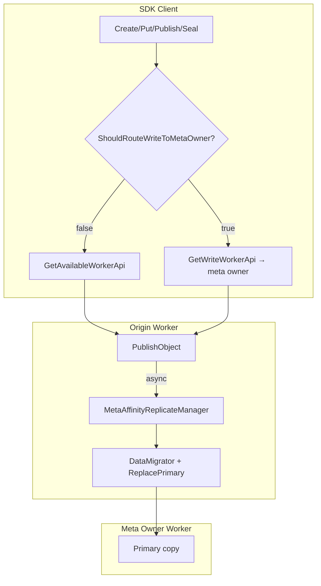

# RFC：Meta-Affinity Write（Primary 与 Metadata Owner Colocate）

**Status**: In-Progress  
**MR**: [!1151](https://gitcode.com/openeuler/yuanrong-datasystem/merge_requests/1151)  
**Branch**: `feature/meta-affinity-write`  
**Author**: yche-huawei  
**Started**: 2026-06-25

---

## 背景与目标描述

Object 的 **metadata owner**（hash 路由）与 **primary copy** 常落在不同 worker：

- **同节点写入**：Client 经 local/gateway worker Publish，primary 初始在 origin worker，需额外 replicate 才与 meta owner colocate。
- **跨节点写入**：无 healthy local worker 时，写路径经 gateway → async replicate，读者 Get 多一次 RPC hop。
- **读侧**：多 location 时若未优先 primary，可能先命中非 primary 副本。

**目标（Phase 1）**：在 `-enable_meta_affinity_replicate=true` 时：

1. 同节点 Publish 成功后 **异步 replicate** 到 meta owner，`ReplacePrimary(remove_location=false)`，origin 保留 local copy。
2. 无 healthy local worker 时，Client **直写 hash 路由的 meta owner worker**，跳过 gateway + async replicate。
3. Master `SelectObjectLocation` **多副本优先 primary**；本地 hit 仍 serve local copy。

**非目标（Phase 1）**：

- 不改变对外 SDK/API 签名。
- 不合并 Meta+Data RPC（见 !1153）。
- 不覆盖 scale 后 full migration 路由（follow-up）。
- flag 默认 **false**，关闭时与现网一致。

**与 Client Direct Read（!1119）关系**：共享 `ReadOnlyHashRingView`；写路径使用独立的 `MetaAffinityClientRingSource`（后续可统一 ring source）。

---

## 建议的方案

### 总体架构



### 写路径门控

| 条件 | 写路径 |
|------|--------|
| `!enable_meta_affinity_replicate` | legacy：`GetAvailableWorkerApi` |
| 有 healthy local worker | legacy + **async replicate**（Publish 后） |
| `enable_meta_affinity_replicate && enable_distributed_master && !HasHealthyLocalWorker()` | **直写 meta owner** |

直写条件与 Client Direct Read 的「无 local worker」门控对称。

### Worker：异步 Replicate

| 组件 | 路径 | 职责 |
|------|------|------|
| `MetaAffinityReplicateManager` | `worker/object_cache/` | 异步队列（hash 分片）、线程池 |
| `MetaAffinityReplicateExecutor` | `worker/object_cache/` | 调度条件、`DataMigrator`、`ReplacePrimary` |
| `WorkerOcServicePublishImpl` | `worker/service/` | binary `PublishObject` 成功后挂接 |

调度条件：`ShouldScheduleMetaAffinityReplicate` — local worker address ≠ meta owner address。

**语义**：`remove_location=false`，origin worker 保留 local copy；读本地 hit 行为不变。

### Client：Remote-only 直写

| 组件 | 路径 | 职责 |
|------|------|------|
| `ReadOnlyHashRingView` | `common/object_cache/` | hash → meta owner 只读计算 |
| `MetaAffinityClientRingSource` | `client/object_cache/meta_affinity/` | etcd bootstrap + gateway `GetClusterState` 刷新 |
| `ObjectClientImpl::GetWriteWorkerApi` | `client/` | Create/Put/Publish/Seal 写 worker 选择 |

### Master：读侧

`OcMetadataManager::SelectObjectLocation`：多 location 时 **优先 primary**。

### 行为矩阵

| Client 场景 | 写路径 | primary @ Put 返回 |
|-------------|--------|-------------------|
| 同节点，meta = origin | Publish | origin |
| 同节点，meta ≠ origin | Publish → async replicate | origin → 迁移后 meta owner |
| 跨节点 + flag | 直写 meta owner | **meta owner** |

### Phase 2 / Deferred

| 项 | 说明 |
|----|------|
| 同节点 client 直写 meta owner | 跳过 async replicate 延迟（~150–190ms） |
| 统一 `MetaAffinityClientRingSource` 与 `ClientHashRingSource` | 与 !1119 共享 ring 刷新 |
| 非 binary Publish 挂 replicate | 当前仅 `PublishBinaryObject` 成功路径 |
| Scale 后写路由 ST | EXCLUSIVE_LEVEL2 风格 |
| Meta-affinity + Direct Read 组合 ST | 端到端写+读 |

---

## 涉及到的对外 API

| 变更 | 说明 |
|------|------|
| 新增 worker gflag | `-enable_meta_affinity_replicate`（bool，**默认 false**） |
| SDK / Client API | **无签名变更** |
| 行为变更 | 仅 flag 开启且满足门控时生效 |

已有 gflag（Client 直写依赖）：`enable_distributed_master`、`master_address`（定义于 `common/util/gflag/cluster_master_flags.cpp`）。

---

## 测试验证

### 功能 UT + ST

| 用例 | 覆盖 |
|------|------|
| `MetaAffinityReplicateTest.*` ×4 | 调度条件、gflag、队列执行 |
| `ColocatePrimaryWithMetaOwnerAndReadLocalCopy` | replicate、双 location、Invalidate 后读 primary |
| `RemoteOnlyClientPutDirectlyOnMetaOwner` | remote-only 直写，primary 立即在 meta owner |

### 性能门禁（optional ST）

环境变量：`DS_META_AFFINITY_WRITE_PERF=1`，Get RPC 模式加 `DS_META_AFFINITY_WRITE_PERF_RPC=1`、`DS_META_AFFINITY_WRITE_PERF_ASSERT=1`。

| 场景 | 结果（tiantiyun，4KB） |
|------|------------------------|
| 同节点 colocated Put+Get vs cross-worker cold Get | ~**70%** Get 延迟降低 |
| 跨节点 W0 reader gateway vs direct cold Get | ~**68%** Get 延迟降低 |

### 验证命令

```bash
ctest --test-dir <build> -R MetaAffinityReplicate -j20 --output-on-failure

DS_META_AFFINITY_WRITE_PERF=1 DS_META_AFFINITY_WRITE_PERF_RPC=1 DS_META_AFFINITY_WRITE_PERF_ASSERT=1 \
  ./tests/st/ds_st_object_cache --gtest_filter='MetaAffinityWritePerfTest.GetRpcReduction*Benchmark'
```

### CI

- **Bazel**：`meta_affinity_replicate_executor` 依赖 `cluster_manager_header`（非 `etcd_cluster_manager_header`）。
- **CMake ST**：`master_address` gflag 统一定义于 `cluster_master_flags.cpp`，worker 侧 `DS_DECLARE`（fix embedded ST 重复定义）。

---

## 期望的反馈时间

**2026-07-06**（约 1 周）

请 Maintainer 重点反馈：

1. 同节点 async replicate vs remote-only 直写的边界是否合理；
2. `remove_location=false` 保留 origin local copy 的读语义是否满足产品预期；
3. Phase 2（同节点直写、ring source 统一）优先级。

---

## 其他信息

- **相关 MR**：[!1151 Meta-affinity write](https://gitcode.com/openeuler/yuanrong-datasystem/merge_requests/1151)
- **关联 MR**：[!1119 Client Direct Read](https://gitcode.com/openeuler/yuanrong-datasystem/merge_requests/1119)、[!1153 Meta+Data RPC 合并](https://gitcode.com/openeuler/yuanrong-datasystem/merge_requests/1153)

### 同节点 Replicate 时序（摘要）

```mermaid
sequenceDiagram
    participant C as Client@W0
    participant W0 as Origin W0
    participant W1 as Meta Owner W1
    participant M as Meta Master

    C->>W0: Publish
    W0->>M: master ops
    W0-->>C: ACK (primary @ W0)
    W0->>W1: DataMigrator
    W0->>M: ReplacePrimary(remove_location=false)
    Note over W0,W1: primary → W1; W0 保留 local copy
```
