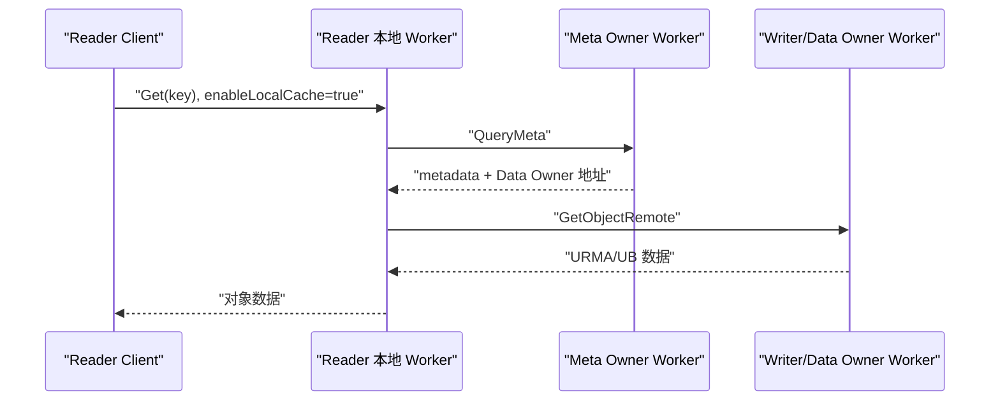
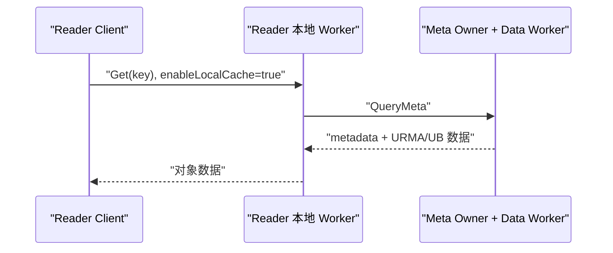
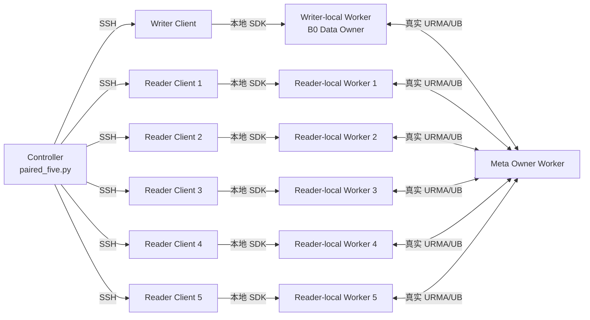

# PR1151 + QueryMeta/UB 合并读取：真实集群实验手册

本文从下载 GitCode PR 代码开始，说明如何在真实跨节点 URMA/UB 集群上完成：

1. 原始代码 B0 与 PR 的五 Reader 并发冷读对照。
2. B0 两段式读取与 PR 一段式读取的 RPC 路径验证。
3. B0 与 PR 写入时延检查。
4. 原始结果收集、统计和证据归档。

本文对应的测试入口位于：

```text
tests/benchmark/meta_affinity_real_cluster/
```

代码仓库和 Merge Request：

- 仓库：<https://gitcode.com/qq_45595516/yuanrong-datasystem>
- Merge Request：<https://gitcode.com/qq_45595516/yuanrong-datasystem/merge_requests/1>

## 1. 实验比较的内容

固定基线 B0：

```text
f21e8db8291a5d8061f87de6d266444f6f3d61ad
```

PR 使用当前分支：

```text
feature/meta-affinity-querymeta-ub-read
```

实验中 Writer 和 Reader 都设置 `enableLocalCache=true`，并且每个 Client 都连接本机健康 Worker。

### 1.1 B0 读取路径



B0 中，Writer 把数据写到自己的本地 Worker；Meta Owner 和 Data Owner 是不同 Worker。因此 Reader 冷读先查 Meta Owner，再去 Data Owner 取数据。

### 1.2 PR 读取路径



PR1151 在前台 Put 返回后异步把数据迁移到 Meta Owner；读取改动让 Meta Owner 在 `QueryMeta` 返回中同时通过 URMA/UB 提供数据。因此成功的一段式读取不再产生第二次 `GetObjectRemote`。

### 1.3 五 Reader 对照关系

正式表格比较的是：

```text
B0 的 5 个 Reader 同时冷读
                  对比
PR 的 5 个 Reader 同时冷读
```

不能拿 PR 五 Reader 与 PR 单 Reader比较。

## 2. 物理拓扑

推荐使用 7 个 Worker 节点和 6 个 Client 执行节点：

| 角色 | Client | 同节点 Worker | 要求 |
|---|---|---|---|
| Writer/Data Owner | Writer Client | Writer-local Worker | B0 数据位于这里 |
| Meta Owner | 无强制 Client | Meta Owner Worker | 必须与 Writer 和 Reader Worker 不同 |
| Reader 1 | Reader Client 1 | Reader-local Worker 1 | 健康同节点 Worker |
| Reader 2 | Reader Client 2 | Reader-local Worker 2 | 健康同节点 Worker |
| Reader 3 | Reader Client 3 | Reader-local Worker 3 | 健康同节点 Worker |
| Reader 4 | Reader Client 4 | Reader-local Worker 4 | 健康同节点 Worker |
| Reader 5 | Reader Client 5 | Reader-local Worker 5 | 健康同节点 Worker |

Controller 可以放在其中任意一台机器，也可以单独使用一台控制机。Controller 只负责通过 SSH 分配任务和收集结果。



所有 6 个 Client 执行节点使用同一份代码和同一个 `meta_affinity_benchmark` 可执行文件。Writer 或 Reader 身份只由运行时 `--task` 参数决定。

## 3. 测试前提

### 3.1 每台机器需要的软件

- Git
- Bash
- Python 3
- CMake 和 C++ 编译器
- `sha256sum`
- `curl`
- SSH Client/Server
- DataSystem 正常构建所需依赖
- 真实 URMA 内核模块、用户态库、UB NIC 和网络配置

真实服务器不得启用 `USE_URMA_MOCK`，也不得使用 `-U on` 构建。

### 3.2 集群一致性要求

B0 和 PR 必须保持以下条件完全相同：

- 物理服务器及 Worker 数量
- Worker ID 和地址
- etcd/metastore 配置
- Hash ring/topology
- CPU 绑核
- 内存和共享内存大小
- UB 设备和端口
- Worker 启动顺序
- 认证配置
- payload、warmup、iterations、repeats
- Writer、Meta Owner 和五个 Reader 的位置
- key manifest

B0 和 PR 顺序执行，不同时运行。先停止 B0，再在相同物理拓扑上启动 PR。

### 3.3 固定 workload

为了与已完成的本地一致性验证对应，正式测试使用：

| 参数 | 值 |
|---|---:|
| Payload | 4 KiB、256 KiB、1 MiB |
| Repeat | 4 |
| 每轮预热 | 20 |
| 每轮计时 Get | 每个 Reader 200 |
| Reader 数量 | 5 |
| Reader 请求间隔 | 0 ms，闭环连续请求 |
| `enableLocalCache` | `true` |

每个 build、每种 payload 最终应得到：

```text
4 repeats × 5 readers × 200 timed Gets = 4,000 个计时样本
```

## 4. 配置 SSH、时钟和认证

Controller 必须能免交互 SSH 到 Writer 和五个 Reader Client：

```bash
ssh user@writer-client-host 'hostname; cat /etc/machine-id; date +%s%3N'
ssh user@reader-client-host-1 'hostname; cat /etc/machine-id; date +%s%3N'
```

对其余 Reader 重复执行。六个 `/etc/machine-id` 必须不同。

所有 Client 时钟必须使用 NTP/PTP 同步。默认允许的最大时钟偏差为 100 ms。

如果 DataSystem 开启认证，必须保证下面的非交互 SSH 命令能够获得站点规定的 SDK 认证环境：

```bash
ssh user@writer-client-host \
  'test -n "${DATASYSTEM_ACCESS_KEY:-}" && test -n "${DATASYSTEM_SECRET_KEY:-}"'
```

不要在 `cluster.b0.json`、`cluster.pr.json`、命令行、Git 或结果包中写入 AK、SK、SSH 密码和 Git token。认证关闭的测试集群不需要设置这两个环境变量。

## 5. 下载并构建 PR

以下操作在所有 Worker/Client 源码节点执行。所有节点必须使用相同绝对路径。

```bash
git clone https://gitcode.com/qq_45595516/yuanrong-datasystem.git \
  /opt/yuanrong-datasystem-pr

git -C /opt/yuanrong-datasystem-pr fetch origin \
  feature/meta-affinity-querymeta-ub-read

git -C /opt/yuanrong-datasystem-pr checkout --detach \
  origin/feature/meta-affinity-querymeta-ub-read

git -C /opt/yuanrong-datasystem-pr rev-parse HEAD
```

记下最后输出的完整 40 位提交号，后面把它写入 PR 配置的 `expected_revision`。

构建真实 URMA 产品和 benchmark：

```bash
cd /opt/yuanrong-datasystem-pr

tests/benchmark/meta_affinity_real_cluster/scripts/build_product_real_urma.sh \
  -j 8

tests/benchmark/meta_affinity_real_cluster/scripts/build_benchmark.sh
```

产品构建脚本固定展开为：

```bash
bash build.sh -P off -X off -j 8 -M on -U off
```

其中：

- `-M on`：构建真实 URMA。
- `-U off`：关闭 URMA Mock。

如果站点要求额外的正常 `build.sh` 参数，可以继续追加到构建脚本后面。

检查 benchmark：

```bash
test -x \
  /opt/yuanrong-datasystem-pr/tests/benchmark/meta_affinity_real_cluster/build/meta_affinity_benchmark

sha256sum \
  /opt/yuanrong-datasystem-pr/tests/benchmark/meta_affinity_real_cluster/meta_affinity_benchmark.cpp

sha256sum \
  /opt/yuanrong-datasystem-pr/tests/benchmark/meta_affinity_real_cluster/build/meta_affinity_benchmark
```

也可以使用一条 bootstrap 命令完成下载和构建：

```bash
tests/benchmark/meta_affinity_real_cluster/scripts/bootstrap_node.sh \
  https://gitcode.com/qq_45595516/yuanrong-datasystem.git \
  feature/meta-affinity-querymeta-ub-read \
  /opt/yuanrong-datasystem-pr \
  -j 8
```

## 6. 下载并构建原始基线 B0

B0 产品代码必须严格固定为：

```text
f21e8db8291a5d8061f87de6d266444f6f3d61ad
```

测试工具在这个历史提交中不存在，所以只把当前 PR 的独立 benchmark 目录导出到 B0 工作区，不修改任何 B0 产品文件：

```bash
git clone https://gitcode.com/qq_45595516/yuanrong-datasystem.git \
  /opt/yuanrong-datasystem-b0

git -C /opt/yuanrong-datasystem-b0 fetch origin \
  feature/meta-affinity-querymeta-ub-read

git -C /opt/yuanrong-datasystem-b0 checkout --detach \
  f21e8db8291a5d8061f87de6d266444f6f3d61ad

git -C /opt/yuanrong-datasystem-b0 archive \
  origin/feature/meta-affinity-querymeta-ub-read \
  tests/benchmark/meta_affinity_real_cluster \
  | tar -x -C /opt/yuanrong-datasystem-b0

git -C /opt/yuanrong-datasystem-b0 rev-parse HEAD
git -C /opt/yuanrong-datasystem-b0 diff --quiet
git -C /opt/yuanrong-datasystem-b0 diff --cached --quiet
```

`rev-parse` 必须输出 B0 完整提交号，两个 `diff` 命令必须返回 0。

构建 B0 产品和同一份 benchmark：

```bash
cd /opt/yuanrong-datasystem-b0

tests/benchmark/meta_affinity_real_cluster/scripts/build_product_real_urma.sh \
  -j 8

tests/benchmark/meta_affinity_real_cluster/scripts/build_benchmark.sh
```

B0 benchmark 链接的是 B0 自己的 `output/cpp` SDK，不会链接 PR SDK。

## 7. 启动真实 Worker

测试包不会替你启动或停止生产形态 Worker，因为 worker 地址、etcd、日志、共享内存、UB device 等参数属于实际部署。

在原有正常 Worker 启动命令中至少保持以下控制变量。

B0：

```text
-enable_urma=true
-enable_data_replication=false
```

PR：

```text
-enable_urma=true
-enable_data_replication=false
-enable_meta_affinity_replicate=true
```

`enable_data_replication=false` 用于避免 Reader 首次读取后在本地留下新副本，确保后续不同 key 仍走冷读路径。它是 benchmark 控制条件，不是产品功能的强制要求。

启动后逐台确认：

1. Worker 健康。
2. Reader Client 连接的是自己的同节点 Worker，通常为 `127.0.0.1:31501`。
3. Writer Client 连接的是 Writer-local Worker。
4. Meta Owner、Writer Worker、五个 Reader Worker 的 ID 互不相同。
5. `curl http://127.0.0.1:31501/prometheus_metrics` 可用。
6. Worker 日志显示真实 URMA 已初始化，没有使用 Mock。
7. Worker 允许 1 MiB Get，UB 最大 Get 大小和共享内存足够。

真实服务器使用实际网络，不添加本地验证用的 `tc netem`。

## 8. 准备正式 key manifest

正式实验必须确保：

- 所有 key 的 Meta Owner 都是配置中的专用 Meta Owner Worker。
- 该 Meta Owner 不是 Writer Worker。
- 该 Meta Owner 不是五个 Reader-local Worker 中的任何一个。
- B0 和 PR 使用完全相同、顺序完全相同的 key 文件。

推荐通过部署环境现有的 hash-ring 查询工具预选 key。不要根据 Worker 名称猜 owner。

固定 workload 需要 12 份 manifest：

```text
3 payload × 4 repeats = 12 files
```

每份文件必须包含：

```text
20 warmup + 200 measured = 220 个唯一 key
```

12 份文件之间也不得复用 key。

例如：

```text
/opt/bench-keys/five-4k-r0.txt
/opt/bench-keys/five-4k-r1.txt
/opt/bench-keys/five-4k-r2.txt
/opt/bench-keys/five-4k-r3.txt
/opt/bench-keys/five-256k-r0.txt
...
/opt/bench-keys/five-1m-r3.txt
```

每行只写一个 key，不要写表头。将同一批文件复制到 Writer 和五个 Reader Client 的同一绝对路径，并校验 SHA-256：

```bash
find /opt/bench-keys -type f -name '*.txt' -print0 \
  | sort -z \
  | xargs -0 sha256sum
```

六个 Client 主机的输出必须完全相同。

## 9. 创建 B0 和 PR inventory

只在 Controller 上操作：

```bash
cd /opt/yuanrong-datasystem-pr/tests/benchmark/meta_affinity_real_cluster

cp cluster.b0.example.json cluster.b0.json
cp cluster.example.json cluster.pr.json
```

填写下面这些字段。

| 字段 | B0 | PR |
|---|---|---|
| `repo_dir` | `/opt/yuanrong-datasystem-b0` | `/opt/yuanrong-datasystem-pr` |
| `results_dir` | B0 独立空目录 | PR 独立空目录 |
| `build_label` | `B0` | `PR` |
| `expected_revision` | 固定 B0 提交 | 当前 PR 完整提交 |
| `expected_location` | Writer/Data Worker ID | Meta Owner Worker ID |
| `writer` | 同一 Writer Client | 与 B0 完全相同 |
| `readers` | 同五个 Reader Client | 与 B0 完全相同 |

以下字段在 B0 和 PR 中必须完全相同：

- `run_id`
- `comparison_id`
- `topology_id`
- `payload_bytes`
- `repeats`
- `warmup`
- `iterations`
- 所有 timeout
- `reader_interval_ms`
- `reader_start_delay_ms`
- `placement`
- `keys_files`
- Writer 和 Reader 的 SSH 地址、Worker 地址与 metrics URL

正式配置应保留：

```json
{
  "payload_bytes": [4096, 262144, 1048576],
  "repeats": 4,
  "warmup": 20,
  "iterations": 200,
  "reader_interval_ms": 0
}
```

为 12 个 case 配置 key 文件，例如：

```json
{
  "keys_files": {
    "five_readers:4096:0": "/opt/bench-keys/five-4k-r0.txt",
    "five_readers:4096:1": "/opt/bench-keys/five-4k-r1.txt",
    "five_readers:4096:2": "/opt/bench-keys/five-4k-r2.txt",
    "five_readers:4096:3": "/opt/bench-keys/five-4k-r3.txt",
    "five_readers:262144:0": "/opt/bench-keys/five-256k-r0.txt",
    "five_readers:262144:1": "/opt/bench-keys/five-256k-r1.txt",
    "five_readers:262144:2": "/opt/bench-keys/five-256k-r2.txt",
    "five_readers:262144:3": "/opt/bench-keys/five-256k-r3.txt",
    "five_readers:1048576:0": "/opt/bench-keys/five-1m-r0.txt",
    "five_readers:1048576:1": "/opt/bench-keys/five-1m-r1.txt",
    "five_readers:1048576:2": "/opt/bench-keys/five-1m-r2.txt",
    "five_readers:1048576:3": "/opt/bench-keys/five-1m-r3.txt"
  }
}
```

不要把认证信息写入 inventory。

## 10. 运行配置检查

先检查 B0/PR 配对条件：

```bash
cd /opt/yuanrong-datasystem-pr/tests/benchmark/meta_affinity_real_cluster

python3 paired_five.py validate \
  --b0-config cluster.b0.json \
  --pr-config cluster.pr.json
```

成功时应看到：

```text
paired-five validation passed
```

再用 dry-run 检查即将执行的 SSH 命令：

```bash
python3 paired_five.py run-b0 \
  --b0-config cluster.b0.json \
  --pr-config cluster.pr.json \
  --dry-run

python3 paired_five.py run-pr \
  --b0-config cluster.b0.json \
  --pr-config cluster.pr.json \
  --dry-run
```

dry-run 不执行 benchmark。

## 11. 运行 B0

确保：

- 当前运行的是 B0 Worker。
- 所有 Worker 都来自 B0 构建。
- `results_dir` 不存在旧结果。
- 集群中没有上一次实验遗留的同名 key。

执行：

```bash
cd /opt/yuanrong-datasystem-pr/tests/benchmark/meta_affinity_real_cluster

python3 paired_five.py run-b0 \
  --b0-config cluster.b0.json \
  --pr-config cluster.pr.json
```

这个命令会自动：

1. 对六个 Client 主机执行 preflight。
2. 检查 Git revision、benchmark 源码 SHA-256 和二进制 SHA-256。
3. 检查六个不同 machine ID。
4. 检查时钟偏差。
5. 由 Writer 写入对象并验证数据位于 Writer/Data Worker。
6. 同时启动五个 Reader。
7. 对每个 payload 执行四轮。
8. 保存 Get、Put、location 和 Prometheus 原始结果。
9. 每个 case 完成后释放 global reference。

收集结果：

```bash
python3 paired_five.py collect-b0 \
  --b0-config cluster.b0.json \
  --pr-config cluster.pr.json \
  --collect-dir collected-five/b0
```

收集完成后停止所有 B0 Worker。

## 12. 运行 PR

在完全相同的物理拓扑、资源限制和 Worker ID 下启动 PR Worker，并增加：

```text
-enable_meta_affinity_replicate=true
```

确认 B0 Worker 已全部停止后执行：

```bash
cd /opt/yuanrong-datasystem-pr/tests/benchmark/meta_affinity_real_cluster

python3 paired_five.py run-pr \
  --b0-config cluster.b0.json \
  --pr-config cluster.pr.json
```

PR Writer 会在前台 Put 计时结束后等待异步迁移，并验证每个 key 的 location 都包含配置的 Meta Owner。

收集结果：

```bash
python3 paired_five.py collect-pr \
  --b0-config cluster.b0.json \
  --pr-config cluster.pr.json \
  --collect-dir collected-five/pr
```

## 13. 生成时延和 RPC 表

```bash
cd /opt/yuanrong-datasystem-pr/tests/benchmark/meta_affinity_real_cluster

python3 summarize.py \
  collected-five/b0 \
  collected-five/pr \
  --csv summary.csv \
  --markdown summary.md \
  --paired-five-csv paired-five.csv \
  --paired-five-markdown paired-five.md

python3 summarize_rpc_metrics.py \
  collected-five/b0 \
  collected-five/pr \
  --csv rpc-metrics.csv \
  --markdown rpc-metrics.md \
  --paired-five-csv paired-five-rpc.csv \
  --paired-five-markdown paired-five-rpc.md
```

文件含义：

| 文件 | 用途 |
|---|---|
| `paired-five.md` | 正式五 Reader B0/PR 平均时延对照 |
| `paired-five.csv` | 同一结果的机器可读版本 |
| `paired-five-rpc.md` | B0 两跳、PR 一跳的 RPC 证据 |
| `summary.md` | 全部 Get、Put 等操作的均值及观察到的最小/最大值 |
| `rpc-metrics.md` | 全部 Prometheus 指标差值 |

所有时延使用算术均值，不使用中位数。误差范围使用实际四轮的最小值和最大值。

## 14. 正确结果必须满足什么

### 14.1 样本完整性

每个 build、每个 payload：

```text
5 readers × 4 repeats × 200 measured Gets = 4,000 samples
```

全部记录必须满足：

```text
status_code = 0
enable_local_cache = true
```

B0 和 PR 的同一 payload/repeat 必须具有相同 `key_set_digest`。

### 14.2 数据位置

- B0：每个 key 的 location 必须包含 Writer/Data Worker。
- PR：每个 key 的 location 必须包含 Meta Owner。

PR 可以同时保留 Writer 上的 origin copy；判断标准是 Meta Owner location 必须存在。

### 14.3 RPC 路径

B0：

```text
QueryMeta > 0
GetObjectRemote > 0
```

PR：

```text
QueryMeta > 0
GetObjectRemote = 0
```

如果 PR 的 `GetObjectRemote` 不为 0，不能把该轮作为“一段式读取成功”的性能数据。

### 14.4 Put

Put 计时只覆盖 `ObjectClient::Put`。location 检查、迁移等待、global reference 和清理都在 Put 计时之外。

用 `summary.md` 中 B0/PR 的 Put 均值及四轮最小/最大值检查 PR 前台写入没有稳定退化。

### 14.5 冷读

- 每个 Reader 每个 key 只读取一次。
- warmup key 与计时 key 不同。
- `enable_data_replication=false`，避免 Reader-local Worker 留下影响后续路径的新副本。

## 15. 失败时如何定位

### `Expected revision ... found ...`

某个 Client 主机没有使用配置中的提交。对六个主机执行：

```bash
git -C /opt/yuanrong-datasystem-pr rev-parse HEAD
git -C /opt/yuanrong-datasystem-b0 rev-parse HEAD
```

### `benchmark sources differ` 或 SHA-256 不一致

B0 导出的测试目录或 PR checkout 不一致。重新执行第 5、6 节，不要手工修改 benchmark 源码。

### `benchmark binaries differ`

六个 Client 的编译输入或 SDK 不一致。清理各自 benchmark build 目录后重新构建，并检查全部节点使用相同架构和依赖。

### `Writer/readers are not on distinct machines`

两个 SSH 入口落到了相同 `/etc/machine-id`。五 Reader 正式实验不允许用同一服务器上的五个进程替代五台 Reader Client。

### `clock spread ... above 100 ms`

先修复 NTP/PTP，再运行。不要简单放大阈值掩盖时钟问题。

### `result already exists`

Runner 有意拒绝覆盖旧数据。更换 `run_id` 和 `results_dir`，或者把旧结果移入单独归档目录。

### `keys did not reach expected location`

依次检查：

1. `expected_location` 是否为准确 Worker ID。
2. key 是否真的归该 Meta Owner。
3. PR Worker 是否启用 `-enable_meta_affinity_replicate=true`。
4. 异步迁移是否报错。
5. `location_timeout_ms` 内集群是否健康。

不要通过删除 `expected_location` 来完成正式测试；这样会失去 Meta/Data 合一的证明。

### PR 仍出现 `GetObjectRemote`

依次检查：

1. PR 是否使用正确提交。
2. Reader 是否连接健康同节点 Worker。
3. Reader Worker 是否启用真实 URMA。
4. Meta Owner 是否已拥有数据。
5. key 是否命中了配置的 Meta Owner。
6. Worker 指标名称是否与当前代码一致。

### 1 MiB 失败

这不是 benchmark 中的 512 KiB 限制。检查：

- Worker 的 UB 最大 Get 大小。
- 注册内存和共享内存容量。
- URMA 初始化及连接状态。
- Worker 日志中的 transport fallback 或 buffer allocation 错误。

不要只修改 PR 一侧的参数；B0 和 PR 必须使用相同资源与 transport 配置。

## 16. 归档实验

至少保留：

```text
experiment/
├── cluster.b0.json              # 删除敏感内容后
├── cluster.pr.json              # 删除敏感内容后
├── keys/                        # 12 份正式 key manifest
├── collected-five/
│   ├── b0/                      # B0 原始 JSONL 和 metrics
│   └── pr/                      # PR 原始 JSONL 和 metrics
├── summary.csv
├── summary.md
├── paired-five.csv
├── paired-five.md
├── rpc-metrics.csv
├── rpc-metrics.md
├── paired-five-rpc.csv
├── paired-five-rpc.md
├── b0-worker-start-command.txt
├── pr-worker-start-command.txt
├── b0-revision.txt
├── pr-revision.txt
└── machine-and-urma-info.txt
```

同时保存：

- B0/PR 完整 Git revision。
- benchmark 源码和二进制 SHA-256。
- 所有 Worker 启动参数。
- UB NIC、驱动、固件和用户态库版本。
- CPU、内存、共享内存限制。
- Worker 日志。
- 每轮开始和结束时间。

在没有确认原始数据完整、RPC 路径正确和 B0/PR 配置一致之前，不应只保留汇总表。

## 17. 最短执行清单

```text
[ ] 7 个 Worker 角色确定，6 个 Client 主机 machine-id 不同
[ ] NTP/PTP 时钟偏差 <= 100 ms
[ ] 真实 URMA/UB 可用，未启用 Mock
[ ] 所有节点下载并构建 PR
[ ] 所有节点下载 B0，导出相同 benchmark，并构建 B0
[ ] 准备 12 份各 220 个 key 的 Meta Owner 定向 manifest
[ ] B0/PR inventory 除 build 专属字段外完全相同
[ ] paired_five.py validate 通过
[ ] B0 Worker 启动，run-b0 和 collect-b0 成功
[ ] B0 完全停止
[ ] PR Worker按相同拓扑启动，run-pr 和 collect-pr 成功
[ ] summarize.py 生成五 Reader 时延表
[ ] summarize_rpc_metrics.py 证明 B0 两跳、PR 一跳
[ ] 每个 build/payload 有 4,000 个成功 Get 样本
[ ] 原始数据、配置、key、日志和版本全部归档
```
