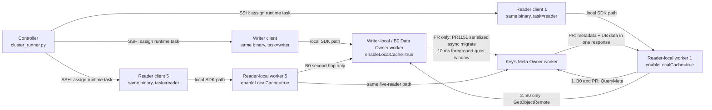

# Meta-affinity real-cluster benchmark

[中文完整实验手册](EXPERIMENT_GUIDE_CN.md)

This package validates PR1151 plus the QueryMeta/UB read merge on real, cross-node workers. It deliberately does not
start an `ExternalCluster` ST topology and does not enable URMA Mock.

Every client host checks out the same DataSystem revision and builds the same `meta_affinity_benchmark` binary. A
runtime `--task` argument assigns that identical binary to the writer, one reader, or one of five concurrent readers.
The inventory is data-driven; no server count, host name, or worker address is compiled into the program.

## Architecture



“Local” means client and its selected worker are on the same node and `ConnectOptions.enableLocalCache=true`.
Writer and readers must be on different nodes, and every reader must have its own healthy same-node worker.
For B0, the key's Meta Owner and Data Owner are different workers: metadata is on `MO`, while data remains on
the writer-local `DW`. Therefore every B0 cold Get performs `QueryMeta` and then `GetObjectRemote`. For PR, the
untimed migration settles before readers start, so `MO` owns both metadata and data and returns both in the
one-step QueryMeta/UB path.

The five-reader performance table must compare **B0 five concurrent readers with PR five concurrent readers**.
It must never compare PR five readers with PR one reader.

## What is in the PR

- Product source can be cloned at the PR revision and built with the repository's normal `build.sh`.
- `scripts/build_product_real_urma.sh` explicitly selects real URMA (`-M on`) and explicitly disables the mock
  (`-U off`).
- `meta_affinity_benchmark.cpp` uses only the public C++ ObjectClient SDK. B0 and PR build the exact same benchmark
  source against their own SDK revision; every client within one build uses the same resulting executable.
- Writer location verification and the `inspect` task split `GetObjMetaInfo` into batches of at most 64 keys, matching
  the public SDK limit even when warmup plus measured iterations exceeds 64.
- `scripts/run_task.sh` chooses `writer`, `reader`, `inspect`, or `cleanup` only at runtime.
- `cluster_runner.py` assigns roles using `cluster.json`, synchronizes five readers with a future wall-clock barrier,
  and fails if the client hosts are not distinct.
- `paired_five.py` rejects B0/PR configurations unless the five client hosts, five reader-local workers, writer,
  topology ID, workload, and key manifests are identical. It also pins B0 to the exact pre-PR1151 commit.
- `summarize.py` reports arithmetic mean plus observed minimum and maximum. It does not substitute p50/p95.
  Its paired mode refuses incomplete B0/PR samples, non-five-reader inputs, or different key-set digests.
- `summarize_rpc_metrics.py` paired mode requires B0 to contain the second `GetObjectRemote` RPC and PR to contain
  none.

The example B0 and PR configurations use `reader_interval_ms: 0`: after the shared start barrier, five clients run a
closed-loop concurrent workload and immediately issue their next cold Get after the previous one completes. If a
fixed-rate workload is required, set the same positive interval in both configurations.

No access key, secret key, SSH password, or Git token belongs in `cluster.json`. ObjectClient uses the normal SDK
authentication environment. SSH is expected to use the site's existing key/agent configuration.

## Worker prerequisites

Use the real-cluster URMA/UB deployment guide for NIC, kernel module, userspace library, and worker startup setup. At
minimum:

1. The distributed-master topology and etcd/metastore configuration must be identical for B0 and PR.
2. Each client has a healthy same-node worker and connects to that worker (normally `127.0.0.1:31501`).
3. Workers are started with real URMA enabled. Do not use `-U on` or `USE_URMA_MOCK`.
4. The PR deployment enables PR1151 meta-affinity replication. B0 uses its original supported flags.
5. Worker count, CPU binding, memory limits, UB device selection, authentication, payloads, warmup, iterations, and
   repeats are held constant between B0 and PR.
6. All client clocks are synchronized by NTP/PTP. The five-reader start barrier is rejected when the configured
   clock-spread limit is exceeded.

Recommended flags for this cold-read comparison are:

```text
B0 workers: -enable_urma=true -enable_data_replication=false
PR workers: -enable_urma=true -enable_data_replication=false -enable_meta_affinity_replicate=true
```

Disabling data replication is a benchmark control, not a requirement of the product feature: after each client buffer
is released, the reader-local worker does not retain the fetched object as a new replica. Together with one unique key
per sample, this keeps every measured Get on the intended cold path. If production validation must keep replication
enabled, retain the unique-key workload and provision enough worker shared memory for the reader-local replicas.

The PR read path has no 512 KiB cutoff. The requested payload must still be no larger than the worker's configured UB
maximum Get size and available shared-memory capacity.

The merged local-cache path is intentionally selected for one-key Get calls, which is the workload used here.
Multi-key Get keeps the existing batch path so one request cannot reserve a maximum-size registered receive buffer for
every key.

## Direct checkout and build on every client

Run the following on every client/worker source host:

```bash
git clone https://gitcode.com/qq_45595516/yuanrong-datasystem.git /opt/yuanrong-datasystem-pr
git -C /opt/yuanrong-datasystem-pr checkout feature/meta-affinity-querymeta-ub-read
cd /opt/yuanrong-datasystem-pr
tests/benchmark/meta_affinity_real_cluster/scripts/build_product_real_urma.sh -j 8
tests/benchmark/meta_affinity_real_cluster/scripts/build_benchmark.sh
```

The product build wrapper expands to:

```bash
bash build.sh -M on -U off -P off -X off
```

Pass any site-required normal build options after the wrapper command. `DATASYSTEM_SDK_ROOT` defaults to
`output/cpp`; set it when the C++ SDK was installed elsewhere.

`scripts/bootstrap_node.sh REPOSITORY_URL GIT_REF DESTINATION` combines clone/fetch, detached checkout, real-URMA
product build, and benchmark build. It refuses to overwrite a non-git destination.

```bash
tests/benchmark/meta_affinity_real_cluster/scripts/bootstrap_node.sh \
  https://gitcode.com/qq_45595516/yuanrong-datasystem.git \
  feature/meta-affinity-querymeta-ub-read \
  /opt/yuanrong-datasystem-pr \
  -j 8
```

## Prepare the B0 checkout without changing B0 product code

The exact pre-PR1151 baseline commit is:

```text
f21e8db8291a5d8061f87de6d266444f6f3d61ad
```

The benchmark source is not part of that historical commit. On every B0 client/worker source host, keep the product at
that commit and export only this PR's standalone harness directory into it:

```bash
git clone https://gitcode.com/qq_45595516/yuanrong-datasystem.git /opt/yuanrong-datasystem-b0
git -C /opt/yuanrong-datasystem-b0 fetch origin feature/meta-affinity-querymeta-ub-read
git -C /opt/yuanrong-datasystem-b0 checkout --detach f21e8db8291a5d8061f87de6d266444f6f3d61ad
git -C /opt/yuanrong-datasystem-b0 archive \
  origin/feature/meta-affinity-querymeta-ub-read \
  tests/benchmark/meta_affinity_real_cluster \
  | tar -x -C /opt/yuanrong-datasystem-b0
cd /opt/yuanrong-datasystem-b0
tests/benchmark/meta_affinity_real_cluster/scripts/build_product_real_urma.sh -j 8
tests/benchmark/meta_affinity_real_cluster/scripts/build_benchmark.sh
```

The exported directory stays untracked, so B0 product files remain byte-for-byte at the baseline commit. The
benchmark links against B0's own `output/cpp` SDK; it does not use the PR client library. `preflight` rejects any
tracked or staged product changes, verifies the B0 commit on every client, and verifies that all client benchmark
binaries have the same SHA-256.

## Inventory

Prepare one inventory per build:

```bash
cp cluster.b0.example.json cluster.b0.json
cp cluster.example.json cluster.pr.json
```

Replace `expected_revision` in `cluster.pr.json` with the full 40-character commit actually deployed. The B0
inventory is already pinned to `f21e8db8291a5d8061f87de6d266444f6f3d61ad`.

The writer and every reader entry describe a client execution host and that client's own local worker. The same
`127.0.0.1:31501` value is expected on different physical hosts. Paired mode requires exactly five readers and
verifies that all six SSH host identities are distinct.

`metrics_url` is required on all five readers in paired mode. The runner stores full Prometheus snapshots immediately
before and after the measured operation on each client-local worker. The default example uses the worker's BRPC
`/prometheus_metrics` endpoint. A lower-level non-paired run may omit it, but then it cannot produce the required RPC
path proof.

`expected_location` is mandatory in paired mode. Set B0 to the exact writer/data worker ID and PR to the exact Meta
Owner worker ID exposed in `ObjMetaInfo.locations`. After foreground Put timing is complete, the writer polls every
key until that location is present.

For the strictest B0/PR pairing, supply `keys_files` in the JSON:

```json
{
  "keys_files": {
    "five_readers:4096:0": "/opt/bench-keys/five-4k-r0.txt"
  }
}
```

Each manifest has exactly `warmup + iterations` unique object keys. Deploy the identical manifests in both builds.
Without manifests, the binary generates deterministic keys from run ID, scenario, payload, and repeat, so identical
configurations still use identical names.

For an authoritative cross-owner result, preselect manifests whose ring Meta Owner is a dedicated worker that is
neither the writer-local worker nor any reader-local worker. Use the exact same manifests for B0 and PR. The generated
keys are convenient for a smoke run, but they do not by themselves prove this placement constraint. In the PR
configuration, set `expected_location` to that Meta Owner's exact worker ID; the writer fails the case unless every
key reaches it after the untimed migration wait.

Both inventories must use the same `comparison_id`, `topology_id`, `run_id`, payloads, repeats, warmup, iterations,
timing controls, key manifests, writer, and five readers. Their identical `placement` block names the B0 writer/data
worker, the separate Meta Owner, and all five reader-local workers. Set B0 `expected_location` to
`placement.writer_data_worker_id`; set PR `expected_location` to `placement.meta_owner_worker_id`.

## Run the paired five-reader task

Validate both inventories before touching the cluster:

```bash
python3 paired_five.py validate \
  --b0-config cluster.b0.json \
  --pr-config cluster.pr.json
```

With the B0 workers running, execute and collect B0:

```bash
python3 paired_five.py run-b0 \
  --b0-config cluster.b0.json \
  --pr-config cluster.pr.json
python3 paired_five.py collect-b0 \
  --b0-config cluster.b0.json \
  --pr-config cluster.pr.json \
  --collect-dir collected-five/b0
```

Then stop B0, start PR on the same physical topology with the same worker flags and resource bindings, and execute
and collect PR:

```bash
python3 paired_five.py run-pr \
  --b0-config cluster.b0.json \
  --pr-config cluster.pr.json
python3 paired_five.py collect-pr \
  --b0-config cluster.b0.json \
  --pr-config cluster.pr.json \
  --collect-dir collected-five/pr
```

`run-b0` and `run-pr` each perform remote preflight before the benchmark. Preflight verifies the exact configured
commit, identical benchmark source SHA-256 on all six client hosts, identical benchmark binary SHA-256 within that
build, distinct Linux machine IDs, and synchronized clocks. Use `--dry-run` first to inspect every SSH command.
`five` starts five separate SSH processes; it does not emulate five readers with threads on one server.

The lower-level single-build commands remain available for Put and single-reader experiments:

```bash
python3 cluster_runner.py preflight --config cluster.json
python3 cluster_runner.py put --config cluster.json
python3 cluster_runner.py single --config cluster.json
python3 cluster_runner.py five --config cluster.json
python3 cluster_runner.py all --config cluster.json
```

The writer measures only `ObjectClient::Put`. Global-reference setup, migration/location verification,
`post_write_wait_ms`, and the post-write location snapshot happen after the measured Put calls. Reader timing covers
only `ObjectClient::Get`; buffer presence, size, and boundary-byte validation happen after the timer stops.

Each measured key is read once per reader-local worker. Warmup keys are separate from measured keys, so measured Gets
are cold at the reader worker.

## Manual role execution

The orchestrator is optional. The identical binary can be assigned manually:

```bash
scripts/run_task.sh writer --worker 127.0.0.1:31501 <common options>
scripts/run_task.sh reader --worker 127.0.0.1:31501 <common options>
scripts/run_task.sh inspect --worker 127.0.0.1:31501 <common options>
scripts/run_task.sh cleanup --worker 127.0.0.1:31501 <common options>
```

Run cleanup only after all readers finish. It releases the remote global reference established by the writer.

## Results

Raw output is one JSON object per operation. It records build label, scenario, client, payload, repeat, iteration,
latency in nanoseconds, completion epoch, status, the fixed `enable_local_cache=true` condition, comparison ID,
topology ID, and a stable digest of the exact key set. Writer result files also contain an untimed `location` row for
every key after the write/migration wait.

When `metrics_url` is configured, each case also produces `_metrics_before.prom` and `_metrics_after.prom`. Subtract
the matching `_count` and `_sum` samples to obtain per-case RPC counts and accumulated time. The primary read-path
evidence is:

- `worker_rpc_query_meta_latency`: one cross-node metadata request in both B0 and PR;
- `worker_rpc_remote_get_outbound_latency`: one extra reader-to-data-worker RPC per B0 cold Get and zero on a
  successful merged PR cold Get;
- `worker_get_post_query_meta_phase_latency`: reader-side work after QueryMeta, which should collapse in the PR path;
- `urma_write_latency` and `urma_wait_latency`: UB transport work on workers where those metrics are exported.

Collect and summarize:

```bash
python3 summarize.py collected-five/b0 collected-five/pr \
  --csv summary.csv \
  --markdown summary.md \
  --paired-five-csv paired-five.csv \
  --paired-five-markdown paired-five.md
python3 summarize_rpc_metrics.py collected-five/b0 collected-five/pr \
  --csv rpc-metrics.csv \
  --markdown rpc-metrics.md \
  --paired-five-csv paired-five-rpc.csv \
  --paired-five-markdown paired-five-rpc.md
```

`paired-five.md` is the authoritative latency table: B0 five concurrent readers versus PR five concurrent readers.
`paired-five-rpc.md` is the path proof: B0 must show QueryMeta plus GetObjectRemote, while PR must show QueryMeta and
zero GetObjectRemote.

Keep the raw JSONL, exact Git commit, inventory (with secrets removed), worker startup flags, UB device information,
and worker logs together. They are the evidence needed for the final B0-versus-PR report.
